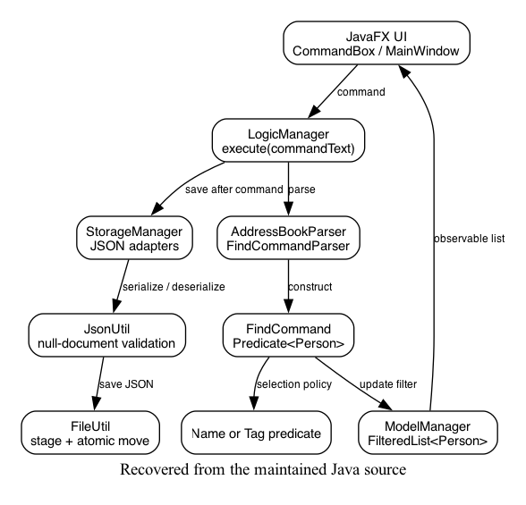
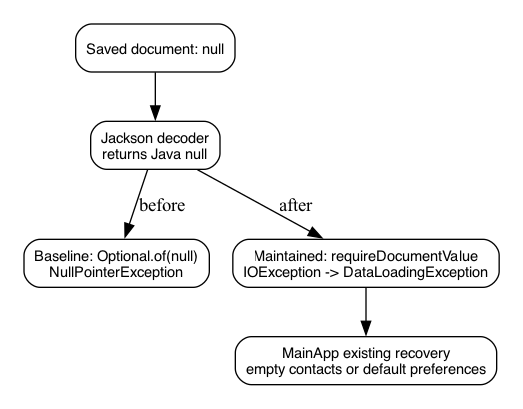
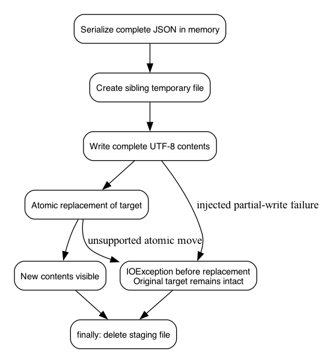
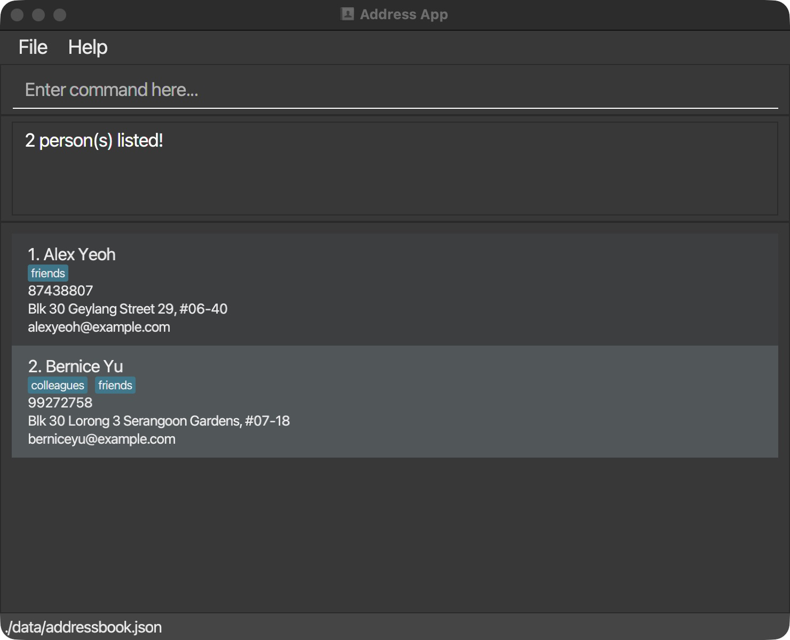
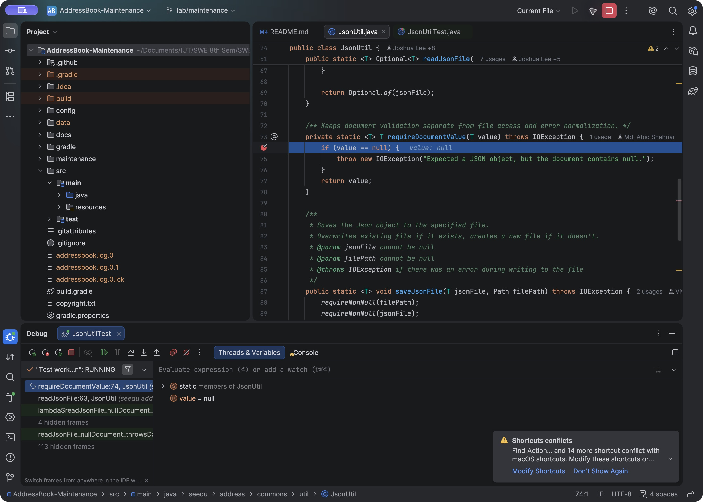

# Software Maintenance of AddressBook Level 3

Islamic University of Technology

Department of Computer Science and Engineering

SWE 4802: Software Maintenance Lab

Md. Abid Shahriar | Student ID: 210042155 | Program: BSc in SWE

Submitted to: Lutfun Nahar Lota, Assistant Professor, CSE, IUT

Report date: 25 October 2026

Recorded verification: 22 October 2026; IntelliJ launcher check: 25 October 2026

<!-- report-body -->

## Contents

| Section | Page |
|---|---|
| 1. Project Overview and Objectives | 2 |
| 2. Adaptive Maintenance: Build and Runtime Compatibility | 3 |
| 3. Corrective Maintenance: JSON Null Handling | 4 |
| 4. Preventive Maintenance: Safer JSON Saves | 5 |
| 5. Perfective Maintenance: Tag-Based Search | 6 |
| 6. Maintenance Activity Matrix | 7 |
| 7. Tools and Verification Results | 8 |
| 8. Findings, Limitations and Demonstration | 9 |
| 9. Conclusion and References | 10 |
| Appendix A. Demonstration Evidence | 11 |

### Report scope

This report covers four maintenance changes to an existing application. Each change includes program comprehension, change management, impact analysis, reverse engineering and refactoring. The implementation order was adaptive, corrective, preventive and perfective maintenance. Source changes, test reports, diagrams and tool outputs are included in the accompanying project folder.

<!-- pagebreak -->

## 1. Project Overview and Objectives

### 1.1 Selected project

AddressBook Level 3 is a Java/JavaFX desktop contact manager developed by se-edu. Contacts contain a name, phone number, email address, address and tags. Users enter commands to add, edit, delete, find and list contacts. Contacts and preferences are stored locally in JSON files.

This work uses an existing project rather than a newly developed application. The upstream source and MIT license are retained. The original revision, 56d1ffbb9cc8df72b97c112fcfdd0cac635652db, is preserved by the local lab-upstream-baseline tag and original-source archive. The maintenance changes are recorded separately on the lab/maintenance branch. Git diffs allow the original and maintained code to be compared.

### 1.2 Objectives

1. Apply one change under each of the four maintenance categories.
2. Explain the five required activities for each change.
3. Use suitable development and analysis tools to inspect and verify the changes.
4. Provide a working demonstration and retain the supporting results.

### 1.3 Application structure

Commands pass through the UI, logic layer and parser before a command object updates the model. The UI observes the model's filtered contact list. The storage layer uses JSON adapters and shared file utilities for persistence.



The diagram was prepared from source inspection and rendered using Graphviz. Doxygen provides separate source documentation and supported class/member relationships. Neither output is treated as a complete runtime dependency graph.

<!-- pagebreak -->

## 2. Adaptive Maintenance: Build and Runtime Compatibility

### Problem and reason for the change

The baseline build failed with invalid source release: 25 in the selected local compiler environment. The original build requested Java 25, while the local target used for this work was Java 21 on macOS ARM64. JavaFX dependencies also listed generic Windows, macOS and Linux classifiers together instead of selecting the host architecture.

Java 21 was a local implementation choice, not an instructor requirement. Installing JDK 25 and keeping the original target was a valid alternative. The chosen change reused the local Java 21 setup and selected native JavaFX artifacts for the Apple Silicon host. The native-dependency finding was separate from the reproduced compiler error.

### 2.1 Program comprehension

The Gradle wrapper, Java configuration, dependency declarations and failed build output were inspected. The review identified the requested source level and the JavaFX platform variants. It also distinguished the JVM running Gradle from the toolchain used by Java tasks.

### 2.2 Change management

The scope was limited to build.gradle. Acceptance criteria were successful compilation and tests with the chosen toolchain, native launch on this Mac, and no intended change to contacts or their JSON format. The change is recorded in commit ddedfbc2; the original configuration remains available for comparison.

### 2.3 Impact analysis

Changing the toolchain could affect language features, library compatibility, tests and packaging. Native dependency selection could affect runtime loading even when compilation succeeds. Compilation, regression tests and a desktop launch were therefore checked separately. Windows and Linux were not verified.

### 2.4 Reverse engineering

The recovered build relationships were Gradle wrapper -> selected toolchain -> compile/test tasks, and host OS/CPU -> JavaFX classifier -> desktop runtime. These relationships were traced manually from the configuration and logs.

### 2.5 Refactoring and implementation

The Java 25 source/target declarations were replaced with an explicit toolchain:

```groovy
java {
    toolchain {
        languageVersion = JavaLanguageVersion.of(21)
    }
}
```

Twelve repeated JavaFX declarations were replaced by one platform selection and a loop over four modules. This host selects mac-aarch64. Centralizing the declarations is the refactoring part; selecting a different toolchain and native artifacts is the adaptive change.

### Result

The adapted build compiled and passed its tests. Later packaging and desktop smoke checks confirmed operation on this Mac. Evidence: 00-baseline-build.txt, 01-adaptive-tests.txt, the build diff and desktop launch records. A later JDK 27 Gradle-launcher run still used application toolchain 21; it was not an application JDK 27 test.

<!-- pagebreak -->

## 3. Corrective Maintenance: JSON Null Handling

### Problem and reason for the change

A file containing only null is valid JSON syntax but not a saved application object. Jackson returns Java null; the original Optional.of(null) then throws NullPointerException outside the IOException catch. This bypasses recovery expecting DataLoadingException.

### 3.1 Program comprehension

MainApp, both storage adapters, JsonUtil and the Optional/exception boundary were traced. A new regression test reproduced the unexpected exception before the fix.

### 3.2 Change management

Acceptance required DataLoadingException for a null document, with valid/missing-file behavior preserved. JsonUtil was changed and one JsonUtilTest added. Commits: 7110f09a (fix), c0060abb (extraction).

### 3.3 Impact analysis

Both storage paths share JsonUtil. Existing MainApp handlers provide empty contacts or default preferences; they were left unchanged. This case concerns the whole document, not null-valued fields.

### 3.4 Reverse engineering

The original and corrected loading paths were recovered from source and recorded in the following flow. Graphviz rendered the manually prepared DOT description.



### 3.5 Refactoring and implementation

Inside the existing try, requireDocumentValue rejects null with IOException. The catch converts it to DataLoadingException; valid values pass unchanged. Helper extraction separates validation from file access while preserving the corrected behavior.

### Result

The null-document regression failed before the fix and passed afterwards. IntelliJ later showed value = null and stepping to IOException. Recovery was inspected in source; no separate corrupt-file GUI startup test was performed. Evidence: 02-corrective-before.txt, 04-corrective-after.txt and IntelliJ records.

<!-- pagebreak -->

## 4. Preventive Maintenance: Safer JSON Saves

### Problem and reason for the change

The original JSON save wrote directly to the target file. A write failure after truncation could leave incomplete data. This change reduces that failure risk; it does not claim a historical user data-loss incident.

### 4.1 Program comprehension

The logic/storage -> JsonUtil -> FileUtil.writeToFile path was traced. Direct target writing could change existing content before replacement bytes were complete.

### 4.2 Change management

Acceptance required complete staging, original-byte preservation after staging failure, UTF-8 and cleanup. Unsupported atomic moves must fail without a non-atomic fallback. Commit: dd9d211b.

### 4.3 Impact analysis

Contacts and preferences share the JSON save path. Staging needs temporary disk space and directory permissions. Atomic replacement depends on filesystem support and may change metadata or symlink behavior. Ordinary FileUtil.writeToFile callers retain their existing behavior.

### 4.4 Reverse engineering

The direct-write path was compared with the staged-save sequence below. The source-derived flow separates serialization, temporary writing, replacement and cleanup.



### 4.5 Refactoring and implementation

JsonUtil now delegates to FileUtil.writeAtomically. The helper writes to a sibling temporary file, requests ATOMIC_MOVE with REPLACE_EXISTING, and attempts cleanup in finally. The common helper centralizes the policy. A package-private ContentWriter parameter allows tests to inject a failing writer.

### Result

Three new tests check successful replacement and cleanup, partial staging failure with original-byte preservation, and nested-directory creation with UTF-8 content. The failure test writes partial temporary content and deliberately throws IOException; it is controlled fault injection, not a physical disk-failure experiment.

The guarantee concerns existing targets during staging failure, not backups or power-loss durability. First-save storage may create an empty target. Evidence: AtomicFileWriteTest, 06-preventive-tests.txt and the diff.

<!-- pagebreak -->

## 5. Perfective Maintenance: Tag-Based Search

### Improvement and reason for the change

Contacts already had tags, but the original find command searched only name words. The selected enhancement adds tag search through a leading t/ prefix. This improves an existing workflow; it does not repair a defect in ordinary name search.

### 5.1 Program comprehension

The existing flow was traced from AddressBookParser through FindCommandParser, FindCommand and the model's filtered list. The name predicate showed how matching could be separated from command execution.

### 5.2 Change management

Acceptance criteria were exact case-insensitive tag matching, OR matching for multiple keywords, rejection of an empty query, and preservation of name search and stored contacts. The feature is commit 7268979e; usage text and a later IDE refactoring were recorded separately.

### 5.3 Impact analysis

The change affects parsing, predicate selection and filtered results. No contact fields or JSON schema were added. Search changes the displayed view rather than deleting contacts; list must restore the full view.

### 5.4 Reverse engineering

The recovered search path is parser -> selected predicate -> FindCommand.execute -> filtered model list -> UI. Doxygen and a JDK-parser AST support source navigation. The AST is a syntax tree, not a control-flow or dependence graph; its retained snapshot predates the final helper extraction.

### 5.5 Refactoring and implementation

FindCommand now accepts Predicate<Person> instead of the concrete name predicate, allowing name and tag rules to reuse filtering/count logic. TagContainsKeywordsPredicate checks whole tags using equalsIgnoreCase and anyMatch. IntelliJ Extract Method later moved tag parsing into parseTagQuery (3c62f6b2).

| Command | Expected behavior |
|---|---|
| find t/FRIENDS | Match friends regardless of case |
| find t/friends colleagues | Match either tag |
| find t/friend | Do not partially match friends |
| find t/ | Reject empty tag query |
| find Alex; list | Preserve name search and restore all contacts |

### Result

Two new integration tests exercise the real parser, commands, predicates and model. They check matching, invalid input, list restoration and unchanged stored count. Manual UI smoke returned Alex Yeoh and Bernice Yu for find t/FRIENDS in the recorded sample state. Test fixtures use different contacts.

The recorded UI result and null-value debugger are reproduced in Appendix A.

<!-- pagebreak -->

## 6. Maintenance Activity Matrix

Each row links one required activity to its application in a maintenance case. The matrix contains twenty activity entries across four changes.

| ID | Activity | Work and evidence |
|---|---|---|
| ADA-PC | Comprehension | Gradle target, selected JDK and JavaFX declarations inspected |
| ADA-CM | Change management | Local target, acceptance criteria, baseline and scoped commit |
| ADA-IA | Impact analysis | Compiler, tests, native runtime and packaging considered |
| ADA-RE | Reverse engineering | Build/toolchain and OS/classifier flows recovered |
| ADA-RF | Refactoring | Repeated dependency declarations centralized |
| COR-PC | Comprehension | JSON decoder, Optional and exception boundaries traced |
| COR-CM | Change management | Failing regression, expected behavior and fix tracked |
| COR-IA | Impact analysis | Shared contact/preferences load and valid/missing data checked |
| COR-RE | Reverse engineering | Null-document failure/recovery flow recovered |
| COR-RF | Refactoring | Validation extracted into requireDocumentValue |
| PRE-PC | Comprehension | Direct-target save boundary identified |
| PRE-CM | Change management | Staging, preservation and cleanup acceptance defined |
| PRE-IA | Impact analysis | Storage callers, space, permissions and filesystem considered |
| PRE-RE | Reverse engineering | Serialization, staging and replacement flow recovered |
| PRE-RF | Refactoring | Common atomic-write helper and writer seam introduced |
| PER-PC | Comprehension | Parser, command, predicate and filtered model traced |
| PER-CM | Change management | Tag syntax, matching rules, tests and commits tracked |
| PER-IA | Impact analysis | Search behavior, count, view and unchanged schema considered |
| PER-RE | Reverse engineering | Search pipeline recovered; docs/AST used as support |
| PER-RF | Refactoring | Predicate interface reused; tag parsing extracted in IntelliJ |

Detailed change records are in maintenance/changes. Original source, commits and exported patches support code comparison. Recorded tests support regression checking; they do not cover every possible input or execution path.

<!-- pagebreak -->

## 7. Tools and Verification Results

The tools were selected for the Java project and the evidence needed for each change. PMD and Checkstyle provide different checks; JUnit results and coverage also answer different questions.

| Tool | Recorded result / output | Purpose |
|---|---|---|
| Gradle / JDK | Baseline failure; maintained build success | Compilation, tasks and packaging |
| JUnit | 245 pass; 0 failures, errors or skips | Regression/integration verification |
| JaCoCo lines | 921/1191 = 77.33% | Measured executable-line coverage |
| JaCoCo branches | 278/327 = 85.02% | Measured branch coverage |
| Checkstyle | Main and test checks pass | Source style checks |
| PMD | 29 initial candidate findings; TXT | Static rule-based analysis |
| CPD | 80 tokens: 0 groups; 50 tokens: 2 | Token-based clone detection |
| Doxygen | Local HTML documentation; warnings saved | Source and relationship browsing |
| Graphviz | Three DOT/PNG diagrams | Render recovered source flows |
| IntelliJ IDEA | Usage/data-flow views, debugger, Extract Method | Navigation, runtime inspection, refactoring |
| JDK Tree API | FindCommandParser AST in TXT | Syntax inspection |
| JFR | Valid 15-second recording and summary | Runtime observation |
| jpackage / UI | Local Mac app image and smoke evidence | Packaging and launch checks |

### 7.1 Test contribution

The suite contains 239 existing tests and six new tests: one JSON-null regression, three atomic-write tests and two tag-search integration tests. The latest frozen full run includes the final parser extraction. Its log is evidence/intellij/10-refactor-fresh-verification.txt. The earlier 09 log ran before the IDE flushed that edit and is superseded.

### 7.2 Reading coverage correctly

Coverage shows which code executed, not the percentage of correct behavior. For example, TagContainsKeywordsPredicate has 5/9 covered lines and 0/6 covered branches in the recorded report. Its matching methods/lambdas executed; the uncovered branches belong to equals. That result should not be interpreted as an unexecuted tag-search feature.

### 7.3 Output locations

Frozen test, coverage and style reports are under evidence/final-*. PMD/CPD text outputs are under evidence/reproduced. Doxygen opens locally from generated/doxygen/html/index.html. Diagram sources/images are under diagrams; IntelliJ screenshots and exports are under evidence/intellij. These files support offline inspection and reproduction.

<!-- pagebreak -->

## 8. Findings, Limitations and Demonstration

### 8.1 Static-analysis findings

PMD findings were treated as candidates requiring context, not as confirmed defects. The initial 29 findings include inherited equals/hashCode and serialization warnings. A reference-identity shortcut is not automatically incorrect, and a J2EE System.exit rule needs different interpretation in a desktop application. Not all findings were changed within the four-case scope.

CPD found no groups at 80 tokens and two small groups at 50 tokens. The smaller groups mainly involve value-object and formatting boilerplate. The thresholds must accompany the results; no measured clone-reduction claim is made. Doxygen warnings include unresolved links and incomplete parameter documentation.

### 8.2 Scope of verification

JavaFX interaction was checked through manual smoke operations, not a complete automated UI suite. The platform checked was Apple Silicon macOS; Windows/Linux and an application JDK 27 toolchain remain unverified. Atomic saving depends on filesystem support and does not provide backup history or fsync-based durability. Initial PMD/CPD, Doxygen and AST outputs describe their recorded snapshots before the final parser helper extraction.

The recorded IntelliJ session includes Find Usages, static Data Flow to Here, a null-value breakpoint, stepping and Extract Method. Usage search is not a complete program slice, and static data flow is not runtime dynamic slicing. Optional Joern/Neo4j setup did not produce an AddressBook CPG; no project CPG/PDG/CDG analysis is reported.

### 8.3 Demonstration sequence

1. Compare the original and maintained build configuration; show baseline failure and adapted success.
2. Explain the null-document path and show the failing/passing regression evidence.
3. Run the interrupted-staging test and explain original-byte preservation.
4. Demonstrate tag search, invalid query, ordinary name search and list restoration.
5. Show the IDE extraction, full test report, coverage and representative static findings.

### 8.4 Reproduction

From the project root, run the following scripts:

```bash
maintenance/tools/verify.sh
maintenance/tools/analyze.sh
maintenance/tools/run-demo.sh
```

The demo script uses a separate local data directory. IntelliJ's saved AddressBook Demo configuration uses the existing seedu.address.Main launcher, not MainApp directly. Focused test runs can replace active test outputs with a subset; frozen full reports are retained separately. Rebuild the local app image after further source changes; the existing image predates the final parser extraction.

<!-- pagebreak -->

## 9. Conclusion and References

### 9.1 Conclusion

The work applies four maintenance changes to AddressBook Level 3. Adaptive maintenance addresses the selected local build/runtime environment. Corrective maintenance routes a null document through the existing loading-error handler. Preventive maintenance stages JSON before replacement to protect existing data during a staged-write failure. Perfective maintenance adds tag search while reusing the existing command and model pipeline.

Each case includes the five required activities, supported by source comparison, change records, diagrams and verification results. The final recorded suite passes 245 tests. Remaining findings and platform/filesystem limits are retained so that the results can be assessed within the scope actually checked.

### 9.2 References

1. se-edu, AddressBook Level 3, source and MIT license: https://github.com/se-edu/addressbook-level3. Original revision: 56d1ffbb9cc8df72b97c112fcfdd0cac635652db.
2. SWE 4802 final-task planning material supplied for the assignment: four maintenance categories and five activities under each.
3. Course lab materials: static/dynamic analysis and slicing; transformation tools; reverse engineering/reengineering; code-clone detection. The separate Lab 2 CPG report was background material, not evidence of an AddressBook CPG run.
4. Gradle, Java toolchains: https://docs.gradle.org/current/userguide/toolchains.html. The recorded project wrapper is Gradle 9.6.1; current online documentation may describe a later release.
5. OpenJFX, Getting Started: https://openjfx.io/openjfx-docs/.
6. Oracle, jpackage Packaging Overview: https://docs.oracle.com/en/java/javase/21/jpackage/packaging-overview.html.

### 9.3 Supporting files

The accompanying folder contains the maintained source and tests, original-source archive, change patches, four change records, expanded activity matrix and tool outputs. REPORT.md is the editable source for this PDF. The short Bangla maintenance notes and tool-output guide are provided separately for demonstration preparation.

The submission archive includes a runnable JAR and generated Doxygen documentation. Local Git metadata, the larger Mac app image and raw JFR recording are excluded from the archive. The package manifest records file hashes for integrity checking.

<!-- pagebreak -->

## Appendix A. Demonstration Evidence

### A.1 Tag-search smoke check

In the recorded sample state, find t/FRIENDS returned Alex Yeoh and Bernice Yu. The query checks case-insensitive tag matching. Current results depend on the data in the demo directory.



### A.2 Null-document debugging

The IntelliJ debugger stopped in requireDocumentValue with value = null. Stepping reached the IOException path; after resume, the three JsonUtil tests passed. The session screenshots and text export are retained under evidence/intellij.


